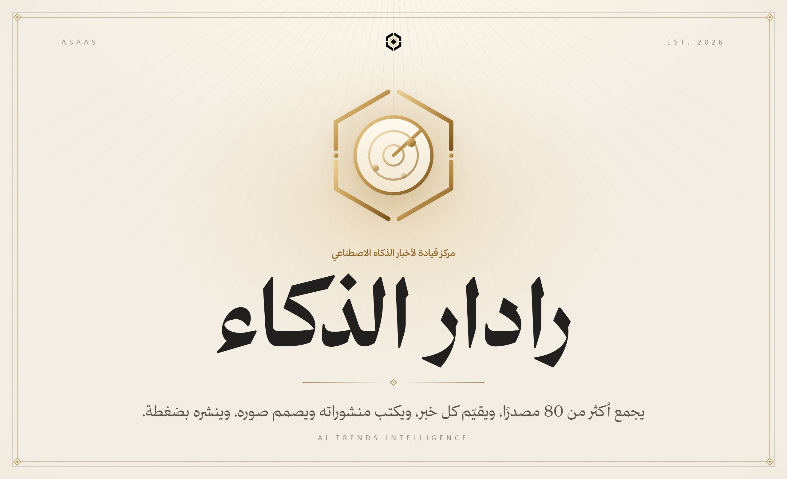
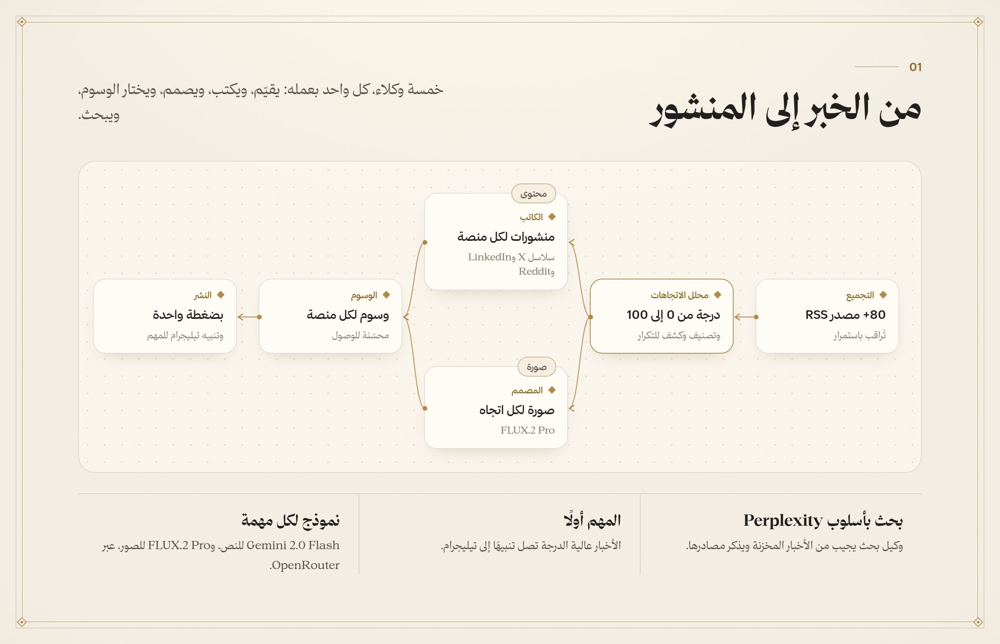
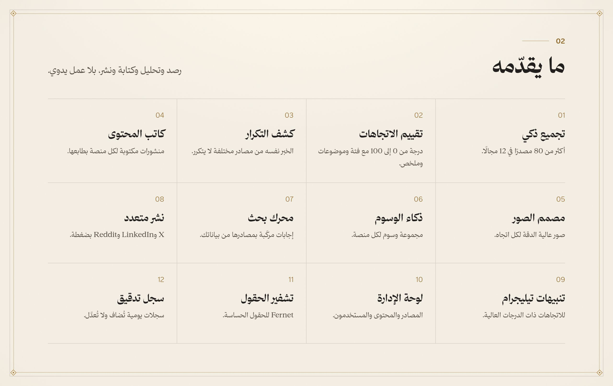
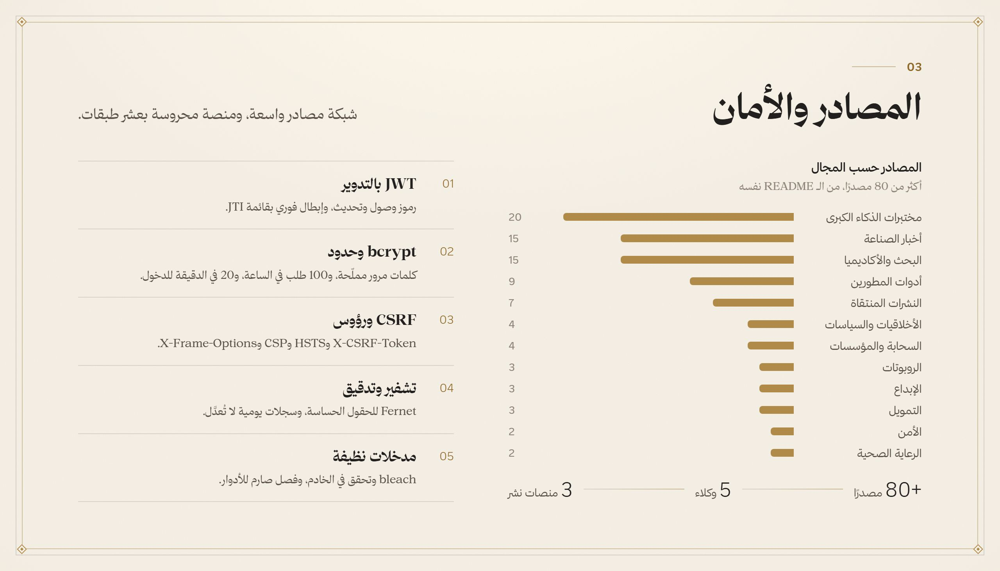
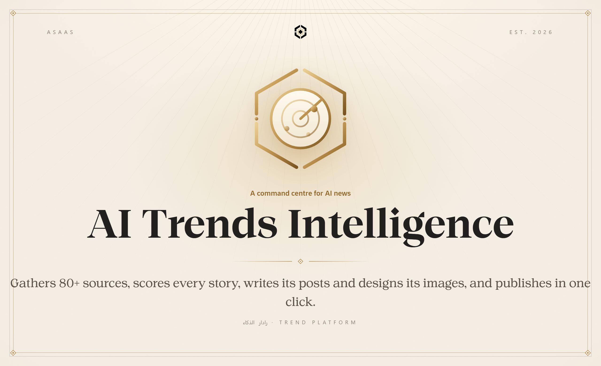
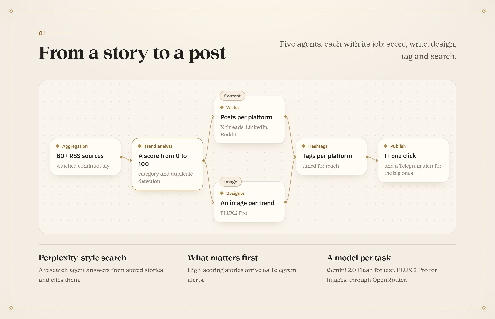
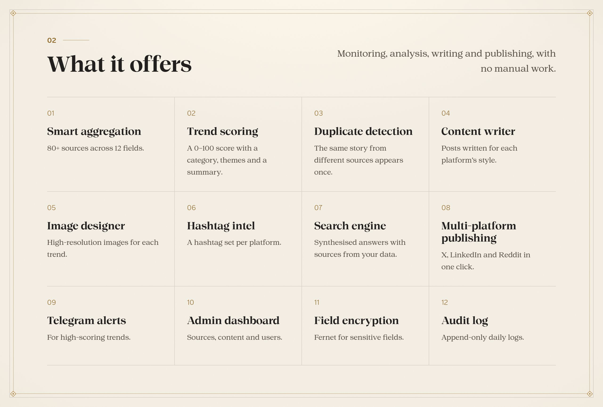
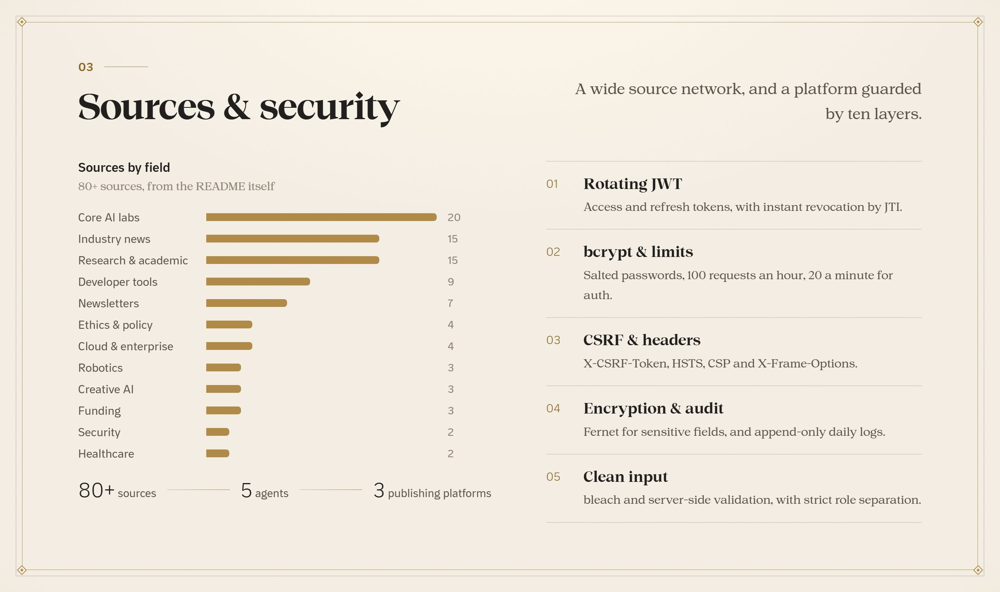

<a name="arabic"></a>

<p align="center"><b>العربية</b> · <a href="#english">English</a></p>



<br>

<div dir="rtl">

عالم الذكاء الاصطناعي يتحرك كل يوم بنماذج وأدوات وشركات جديدة، ومتابعته مستحيلة يدويًا. هذه المنصة تجمع أكثر من 80 مصدرًا، ويقيّم وكلاؤها كل خبر من 0 إلى 100، ويكتبون منشوراته لكل منصة ويصممون صوره ويختارون وسومه، ثم تنشره بضغطة وتنبّهك بالمهم على تيليجرام، ومعها محرك بحث يجيب من الأخبار بمصادرها.

</div>

<br>







<br>

<div dir="rtl">

## التشغيل

```bash
python -m venv venv
venv/Scripts/pip install -r requirements.txt
# OPENROUTER_API_KEY في .env، وتيليجرام والنشر اختياريان
python app.py
```

الدليل الكامل بالإنجليزية في [`docs/GUIDE.md`](docs/GUIDE.md): قائمة المصادر كاملة، والوكلاء، ونموذج الأمان، والنشر.

</div>

<p align="center"></p>

<a name="english"></a>

<p align="center"><a href="#arabic">العربية</a> · <b>English</b></p>



<br>

AI moves every day with new models, tools and companies, and following it by hand is impossible. This platform gathers 80+ sources; its agents score every story from 0 to 100, write its posts for each platform, design its images and pick its hashtags, then publish in one click and alert you on Telegram to what matters, with a search engine that answers from the stories and cites them.

<br>







<br>

## Running it

```bash
python -m venv venv
venv/Scripts/pip install -r requirements.txt
# OPENROUTER_API_KEY in .env; Telegram and publishing are optional
python app.py
```

The full guide is in [`docs/GUIDE.md`](docs/GUIDE.md): the full source list, the agents, the security model and deployment.

<p align="center"></p>

<p align="center"></p>

<p align="center">
  <sub>جزء من منظومة <b>أساس</b> · Part of the <b>Asaas</b> ecosystem</sub>
  <br>
  <sub>من تصميم وبناء <a href="https://github.com/AladdinAlynaey">علاء الدين اليناعي</a> · Designed and built by <a href="https://github.com/AladdinAlynaey">Alaadin Alynaey</a></sub>
  <br>
  <sub>© 2026 · جميع الحقوق محفوظة · All rights reserved</sub>
</p>
